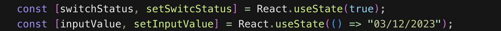
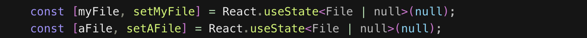
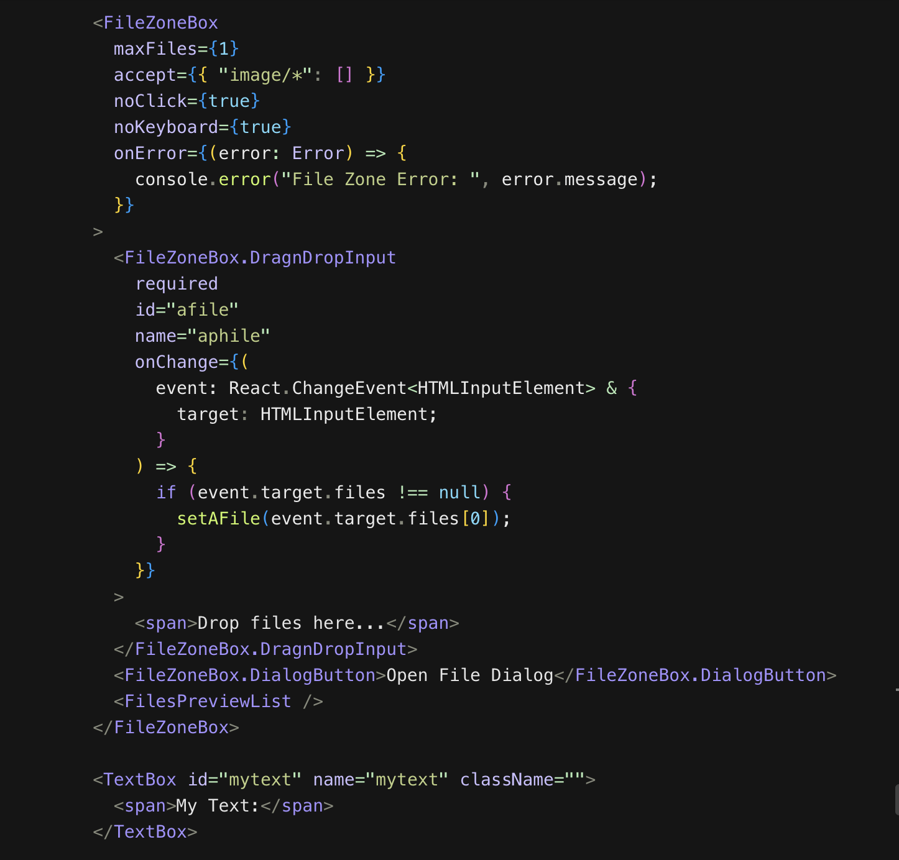
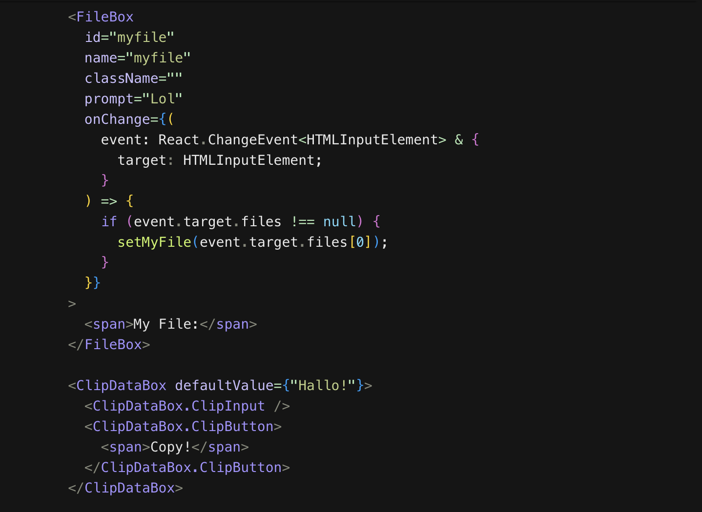
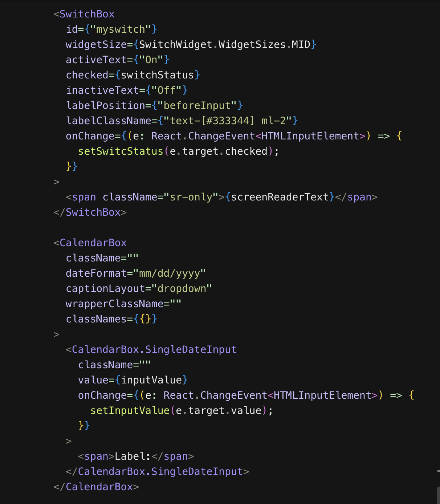

[](https://github.com/prettier/prettier) [](http://makeapullrequest.com)

# react-busser-headless-ui
A progressive, unstyled, accessible, atomic, highly flexible and configurable headless UI component library for ReactJS.

>**HIGHLIGHTS**

_We all deserve a UI library that allows us to ship minimal CSS to devices, demands minimal boilerplate to create simple and complex components, deploys flexible theming options and doesn't lock us into a particular CSS framework (e.g. **Tailwind**, **Bulma**, **Bootstrap**)._

_Finally, a UI library that ties UI components to routers (e.g. app/page **NextJS_Router**, **Tanstack_Router**, **React_Router**) to ensure more cohesive functionality and behavior especially for components like **&lt;Tabs&sol;&gt;** and **&lt;Modals&sol;&gt;**._

Therefore, **react-busser-headless-ui**:

- Ships with zero styles (Paint on a blank canvas - no colors and no shadows except the ones you define)
- Uses modern [HTML](https://en.wikipedia.org/wiki/HTML5) tags for component structure where necessary (e.g. **&lt;details&gt;**, **&lt;summary&gt;**, **&lt;dialog&gt;** and **&lt;menu&gt;**)
- Minimizes the use of `useState(...)` for everything especially for things [CSS](https://en.wikipedia.org/wiki/CSS3_(disambiguation)#:~:text=CSS3%20is%20an%20abbreviation%20for,stylesheet%20language%20for%20structured%20documents.) or [Smart HTML Tags](https://dev.to/maxprilutskiy/html5-elements-you-didnt-know-you-need-gan) can already handle. (e.g. toggle the visibility of a DOM node or capturing invalid state)
- Reduces boilerplate associated with setting up a component especialy around structure, testability and reusability.
- Also, makes use of the very best third-party libraries to handle forms, tables with pagination, toasts, utilities and state management (i.e. [**react-hook-form**](https://react-hook-form.com/docs), [**react-busser**](https://github.com/codesplinta/busser/blob/main/README.md), [**@tanstack/react-table**](https://tanstack.com/table/v8), [**react-day-picker**](https://daypicker.dev/), [**react-dropzone**](https://react-dropzone.js.org/#src) & [**sonner**](https://sonner.emilkowal.ski/getting-started)

<!--



-->

## Preamble

There are lots of headless UI libraries out there (e.g. [**Material UI**](https://mui.com/), [**Radix UI**](https://www.radix-ui.com/) e.t.c). While many of these UI libraries give you the flexibility and atomicity to build what you want in a fairly easy manner, they don't give you a lot of options for configuration. Sometimes, all you have [a set of strict primitives](https://www.radix-ui.com/primitives) that lock you into a specific pattern for building your components on an atomic level or [bloated themeing configurations](https://mui.com/material-ui/customization/theme-components/) whose styling defaults aren't helpful to you in relation to your custom design system for UI widgets/components. Furthermore, `useState()` is over used for things that [CSS](https://en.wikipedia.org/wiki/CSS3_(disambiguation)#:~:text=CSS3%20is%20an%20abbreviation%20for,stylesheet%20language%20for%20structured%20documents.) can do already. **react-busser-headless-ui** steps into these gaps with superior rendering performance and optimized state management.

One of the reasons i started this project is that i kept waiting for [**Radix UI**](https://www.radix-ui.com/) to support [**DatePicker primitives** but till date it doesn't](https://github.com/radix-ui/primitives/discussions/969).

This project is also inspired (in part) by [**Base UI**](https://github.com/mui/base-ui) which is a collaborative effort from the team members of the [**Material UI**](https://mui.com/) and [**Radix UI**](https://www.radix-ui.com/) projects. However, still fundamentally different.

## Getting Started

```bash
npm install react-busser-headless-ui
```

```bash
yarn add react-busser-headless-ui
```


## Docs
>TABS:

```jsx
import React from "react";
import { useTabs, Tabs } from "react-busser-headleess-ui";

const [ activate, id, tabIndex ] = useTabs("group_settings_tab", 1);
 
<Tabs activeTabIndex={tabIndex} activeTabIdQuery={id}>
   <Tabs.Header>
     <Tabs.Title>General</Tabs.Title>
     <Tabs.Title>Members</Tabs.Title>
   </Tabs.Header>
   <Tabs.Body>
     <Tabs.Panel>
       <h4>General Settings</h4>
       <p>All settings for user app</p>
     </Tabs.Panel>
     <Tabs.Panel>
       <h4>>Member settings</h4>
       <p>Seetings for group members</p>
     </Tabs.Panel>
  </Tabs.Body>
</Tabs>
```

>CHECKBOX:

```jsx
import { useState } from "react";
import { CheckBox } from "react-busser-headless-ui";

const [toggle, setToggle] = useState<boolean>(false);

const 
 <CheckBox
  name="checky"
  id="checky"
  checked={toggle}
  checkIconSize={18}
  displayStyle={"adjusted"}
  onChange={(
    event: React.ChangeEvent<HTMLInputElement> & {
      target: HTMLInputElement;
    }
  ) => {
    setToggle(event.target.checked);
  }}
>
  <span>Label:</span>
</CheckBox>
```

>FILEBOX + FILEZONEBOX (For File Uploads)

```jsx
import { useState } from "react";
import { FileBox, FileZoneBox } from "react-busser-headless-ui";

const [file, setFile] = useState<File | null>(null);
const [files, setFiles] = useState<File[]>([]);

<FileBox
  id={"myfile"}
  name={"myfile"}
  className={"inline-flex"}
  prompt="Ready!"
  onChange={(
    event: React.ChangeEvent<HTMLInputElement> & {
      target: HTMLInputElement;
    }
  ) => {
    if (event.target.files !== null) {
      setFile(event.target.files[0] || null);
    }
  }}
>
  <span>Label:</span>
</FileBox>

<FileZoneBox
  maxFiles={2}
  accept={{ "images/*": [".png", ".jpeg", ".jpg"] }}
  noClick={true}
  noKeyboard={true}
>
  <FileZoneBox.DragnDropInput
    required
    id={"files"}
    name={"files"}
    onChange={(
      event: React.ChangeEvent<HTMLInputElement> & {
        target: HTMLInputElement;
      }
    ) => {
      if (event.target.files !== null) {
      setFiles(event.target.files || []);
    }
   }}
  >
   <span>Drop files here...</span>
  </FileZoneBox.DragnDropInput>
  <FileZoneBox.DialogButton>
    Open File Dialog
  </FileZoneBox.DialogButton>
</FileZoneBox>
```

>TEXT INPUT

```jsx
import { TextBox } from "react-busser-headless-ui";

<TextBox id="mytext" name="mytext" className={"bg-black"}>
  <span>Label:</span>
</TextBox>
```

>KEYSHORTCUT (For Hot Keys)

```jsx
import { KeyShortcut } from "react-busser-headless-ui";

<KeyShortcut modifier={"mod"} symbol="s">
  <KeyShortcut.Summary text={"trigger a fullscreen"} />
</KeyShortcut>
```

>ACCORDION

```jsx
import { Accordion } from "react-busser-healdess-ui";

<Accordion
  defaultName={"item_1"}
  aria-label={"Frequently asked questions"}
>
  <Accordion.Card name={"item_1"} className={"card"}>
    <Accordion.Trigger>{"Item 1"}</Accordion.Trigger>
    <Accordion.Content>
      <p>Details of Item 1</p>
    </Accordion.Content>
  </Accordion.Card>
  <Accordion.Card name={"item_2"}>
    <Accordion.Trigger>{"Item 2"}</Accordion.Trigger>
    <Accordion.Content>
      <p>Details of Item 2</p>
    </Accordion.Content>
  </Accordion.Card>
</Accordion>
```

>CLIPDATABOX

```jsx
import { ClipDataBox } from "react-busser-headless-ui";

<ClipDataBox defaultValue={"Hallo!"}>
  <ClipDataBox.ClipInput />
  <ClipDataBox.ClipButton>
    <span>Copy!</span>
  </ClipDataBox.ClipButton>
</ClipDataBox>
```

>MODAL

```jsx
import { Modal, useModal } from "react-busser-headless-ui";

const DeleteConfimationModal = ({ id }: { id: string }) => {
    return (<>
        <div id={id}>
            <Modal.Header as={"div"} className={"flex justify-between"}>
                <h5>Delete Item</h5>
            </Modal.Header>
            <Modal.Body>
                <p>Are you sure you want to delete ?</p>
            </Modal.Body>
            <Modal.Footer className={"flex items-center justify-center"}>
                <button>Cancel</button>
                <button>Yes</button>
            </Modal.Footer>
        </div>
    </>);
};

export const useConfirmationModal = () => {
  const id = "Confirmation_Delete_Item";
  const { showModal, closeModal, isModalVisible } = useModal(id);
  const showConfirmatioModal = () => {
    return showModal(
      <DeleteConfimationModalContent
        id={id}
      />
    );
  };
  const closeConfirmatioModal = () => {
    closeModal(id);
  };

  return {
    isConfirmatioModalVisible: isModalVisible,
    showConfirmatioModal,
    closeConfirmatioModal
  };
};
```

>POPOVER

```jsx
import { PopoverBox } from "react-busser-headless-ui";

<PopoverBox>
  <PopoverBox.Trigger isToggle>
    <button>Go for It!</button>
  </PopoverBox.Trigger>
  <PopoverBox.Content
    position={{ horizontalAnchor: "left", verticalAnchor: "top" }}
  >
    <span>HelloYammy!</span>

    <PopoverBox.Close>
      <button>Close</button>
    </PopoverBox.Close>
  </PopoverBox.Content>
</PopoverBox>
```

>CALENDAR

```jsx
import { useState } from "react";
import { CalendarBox } from "react-busser-headless-ui";
import { getDefaultClassNames } from "react-day-picker";

const defaultClassNames = getDefaultClassNames();

const [inputValue, setInputValue ] = useState("10/23/2026");

<CalendarBox
  className="mt-2"
  dateFormat="mm/dd/yyyy"
  captionLayout="dropdown"
  wrapperClassName="flex"
  classNames={{
   root: `${defaultClassNames.root} shadow-lg p-5`,
   chevron: `${defaultClassNames.chevron} fill-amber-500`
 }}
>
  <CalendarBox.SingleDateInput
    className={"block"}
    value={inputValue}
    onChange={(e: React.ChangeEvent<HTMLInputElement>) => {
      setInputValue(e.target.value);
    }}
  >
    <span>Label:</span>
  </CalendarBox.SingleDateInput>
</CalendarBox>
```

>CODEENTRYBOX (For OTP Input)

```jsx
import { useState } from "react";
import { CodeEntryBox } from "react-busser-headless-ui";

const numberOfDigits = 6;
const [code, setCode ] = useState("");

<CodeEntryBox
  name="otp"
  wrapperClassName={"otpbox"}
  slots={numberOfDigits}
  title={"OTP"}
  onChange={(event: React.ChangeEvent<HTMLInputElement>) => {
    console.log("haha! ", event.target.value);
    const value = String(event.target.value);

    if (value.length === numberOfDigits) {
      setCode(value);
    }
  }}
>
  <CodeEntryBox.Input className={"otpinput"} />
</CodeEntryBox>
```

> TABLE + PAGINATOR (Using @tanstack/react-table)

```jsx
import { flexRender } from "@tanstack/react-table";
import {
  useDataScopedPaginatorProps,
  Table,
  Paginator
} from "react-busser-headless-ui";

import type { ColumnDef } from "@tanstack/react-table";

  type Person = {
    name: string,
    email: string,
  };

  const people = [
    {
      name: 'tanner linsey',
      email: 'linsley@nozzle.io',
    },
    {
      name: 'molly sanchez',
      email: 'sanchez@sportax.com',
    }
  ];
  
  const columns: Array<ColumnDef<Person, any>> = [
    { accessorKey: "name", header: "Name" },
    { accessorKey: "email", header: "Email" }
  ];
  
  const { props: paginatorProps, table } = useDataScopedPaginatorProps({
    data: people,
    columns,
    pageSize: 25,
    pageSearchParamName: "page",
    pageSliceSpanActive: true
  });
  
  <Table stackBelow={560}>
    <Table.Caption>Services</Table.Caption>
    <Table.Content>
      {table.getRowModel().rows.map((row) => (
        <Table.Row key={row.id}>
          {row.getVisibleCells().map((cell) => (
            <Table.TitleColumn sticky="left" key={cell.id + "0"}>{cell.getValue()}</Table.TitleColumn>
            <Table.ContentColumn data-label="Price" key={cell.id + "1"}>
              {flexRender(cell.column.columnDef.cell, cell.getContext())}
            </Table.ContentColumn>
          ))}              
        </Table.Row>
      ))}
    </Table.Content>
  </Table>
  
  <Paginator className={"flex flex-column"} {...paginatorProps}>
    <Paginator.LinkGroup className={"flex flex-row"}>
      <Paginator.ControlLink className={""} kind={"prev"}>
        <span>Previous</span>
      </Paginator.ControlLink>
      <Paginator.RangeLinks
        className={""}
        wrapperClassName={""}
        currentPageActiveClassName={""}
      />
      <Paginator.ControlLink className={""} kind={"next"}>
        <span>Next</span>
      </Paginator.ControlLink>
    </Paginator.LinkGroup>
  </Paginator>
```

>PAGINATOR (Without @tanstack/react-table)

```jsx
import { useRenderScopedPaginatorProps, Paginator } from "react-busser-headless-ui";

const { props: paginatorProps } = useRenderScopedPaginatorProps({
  pageSearchParamName: "page",
  pageSliceSpanActive: true,
  totalPageCount: Math.ceil(rows.length / rowsPerPage),
  initialCurrentPage: 1
});

<Paginator className={"flex flex-column"} {...paginatorProps}>
  <Paginator.Caption textTemplate={"> Page %d of %d"} />

  <Paginator.LinkGroup className={"flex flex-row"}>
    <Paginator.ControlLink className={""} kind={"prev"}>
      <strong>&lt;</strong>
      <span>Previous</span>
    </Paginator.ControlLink>
    <Paginator.RangeLinks
      className={""}
      wrapperClassName={""}
      currentPageActiveClassName={""}
    />
    <Paginator.ControlLink className={""} kind={"next"}>
      <span>Next</span>
      <strong>&gt;</strong>
    </Paginator.ControlLink>
  </Paginator.LinkGroup>
</Paginator>
```

## License

Apache 2.0
